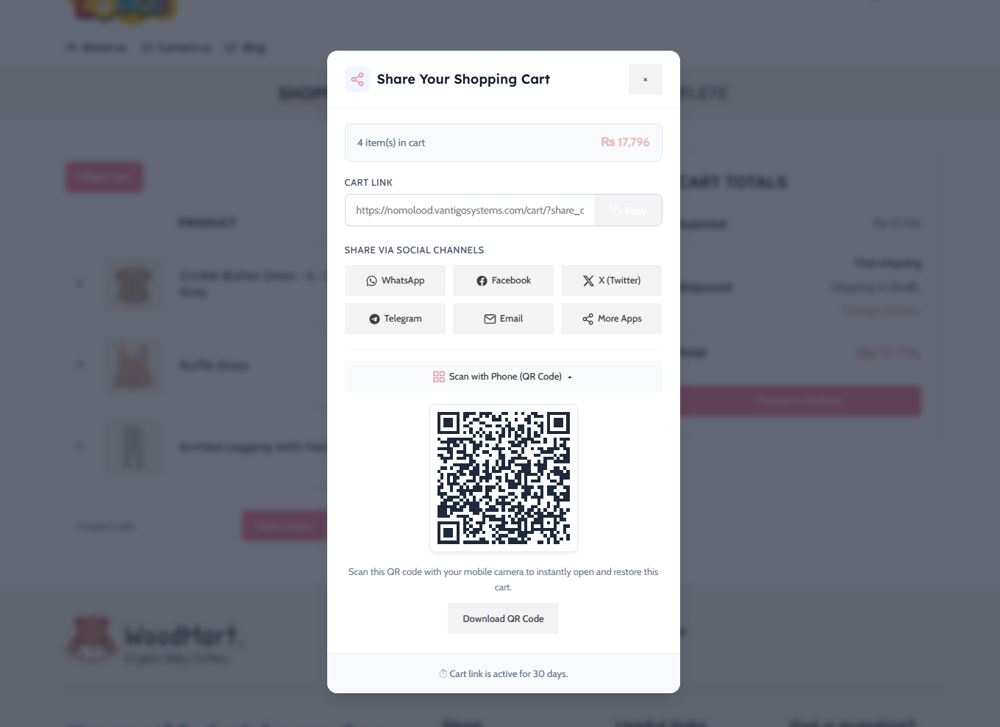

# Vantigo Share Shop Cart for WooCommerce

Share a WooCommerce shopping cart through a link, QR code, or an optional sharing channel. Recipients confirm before loading the shared items into their own cart.

**Version:** 1.0.3 · **License:** GPL-2.0-or-later  
**Author:** Musaib Jeelani — [Vantigo Systems](https://vantigosystems.com)

[WordPress.org plugin page](https://wordpress.org/plugins/vantigo-share-shop-cart-for-woocommerce/)



## Features

- Shareable cart links and QR codes generated locally in the browser.
- Optional WhatsApp, Facebook, X, Telegram, email, SMS, and native device sharing.
- Classic cart placement, WooCommerce Cart block support, optional shop/product placement, and a floating button.
- Elementor widget and shortcodes for manual placement.
- Replace or merge shared items, restore coupons, configure expiry, and optionally redirect to checkout.
- Local cart activity reporting and scheduled cleanup of expired shared carts.
- Button color and border-radius controls.

## Requirements

- WordPress 5.6 or later.
- PHP 7.4 or later.
- An active, compatible WooCommerce installation. The WooCommerce release you choose may require newer WordPress or PHP versions.
- Elementor is optional and is required only for the Elementor widget.

## Install

### WordPress.org

In WordPress, open **Plugins → Add New**, search for **Vantigo Share Shop Cart for WooCommerce**, install, and activate it.

### GitHub download

1. Prefer a published **Release** ZIP for a stable version. **Code → Download ZIP** downloads the current branch, which may contain unreleased work.
2. In WordPress, open **Plugins → Add New → Upload Plugin**, choose the ZIP, and install it.
3. Activate WooCommerce and then this plugin.
4. Open **WooCommerce → Vantigo Share Shop Cart** to configure it.

For manual installation or a Git clone, place this repository's contents directly in `wp-content/plugins/vantigo-share-shop-cart-for-woocommerce/`. The main PHP file and `readme.txt` must be at that folder's root. A copy under a web server's `www` directory is a repository working copy; it becomes a WordPress plugin only after installation in a WordPress site's plugins directory.

Use only one installed copy. Before replacing an earlier test build with a differently named directory, deactivate that build and back up the site. Settings and shared-cart migration from earlier review builds are included.

## Usage

The cart button can be placed automatically through settings or manually with these shortcodes:

```text
[vantshsh_share_cart]
[vantshsh_share_cart layout="inline"]
[vantshsh_share_cart text="Share My Cart" show_qr="yes"]
[vantshsh_cart_url]
```

PHP theme templates can use:

```php
<?php
if ( function_exists( 'vantshsh_render_share_cart' ) ) {
    vantshsh_render_share_cart();
}
```

In Elementor, search for the **Vantigo Share Shop Cart** widget.

## Screenshots

The [screenshots directory](docs/screenshots/) contains the cart button, sharing dialog, settings, styling, activity history, and Elementor/shortcode guide. Ordered captions are also included in [readme.txt](readme.txt).

## Privacy and external services

Cart records and activity are stored on the shop's own website. Social destinations receive sharing information when a visitor clicks the corresponding button. Anyone with a valid shared-cart link can load its items and coupons until it expires. Store owners should review custom cart-item metadata added by other extensions before enabling sharing.

See [readme.txt](readme.txt) for the complete service disclosures, provider terms/privacy links, retention behavior, and migration notes.

## Contributing and security

Bug reports, documentation improvements, translations, compatibility fixes, and pull requests are welcome. Read [CONTRIBUTING.md](CONTRIBUTING.md) before submitting a change. Report vulnerabilities privately as described in [SECURITY.md](SECURITY.md).

## License

Plugin code is licensed under **GPL version 2 or, at your option, any later version**. See [LICENSE](LICENSE). The bundled QRCode.js library retains its [MIT license](assets/js/qrcode-LICENSE.txt).
